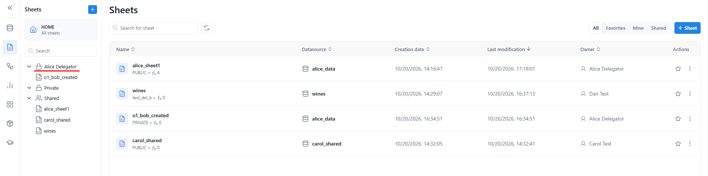

# User delegation

**User delegation** lets one user act on behalf of another — for example, when a colleague takes over the work of someone who is away or has left the company. While a delegation is active, the delegate keeps their own access and also gets the delegator's: their content, their shares and their workspace permissions. A delegation is set up and removed by a KAWA administrator.

> **Terminology:** In this document, "principal" refers to a KAWA user account. The terms are used interchangeably.

## 1. How delegation works

| Term       | Meaning                                                                |
| ---------- | ---------------------------------------------------------------------- |
| Delegator  | The user whose access is lent                                          |
| Delegate   | The user who receives that access and acts on the delegator's behalf   |
| Delegation | The link from the delegator to the delegate, stored on the delegator   |

* **Who can set it up** — KAWA administrators only. There is no screen for delegation in the KAWA interface; administrators use the `ReplaceUserDelegation` command (see section 6).
* **No impersonation** — the delegate still signs in as themselves, and the delegator can keep working in parallel.
* **One delegate per delegator** — a delegator delegates to one user at a time, but several users can delegate to the same delegate, who then gets the access of all of them.
* **Always one step** — a delegation never forms a chain. If Alice delegates to Bob and Bob then delegates to Carol, Alice's delegation is moved to Carol as well: both Alice and Bob now delegate directly to Carol.
* **Temporary by design** — a delegation stays in place until an administrator removes it.

## 2. What the delegate can do

| Area                  | What the delegate gets                                                                                                                                                                 |
| --------------------- | -------------------------------------------------------------------------------------------------------------------------------------------------------------------------------------- |
| Private content       | Sees and opens the delegator's private sheets, views, dashboards, workflows and data sources. In the folder tree, the delegator's private folder appears as a separate root labelled with the delegator's name. |
| "Mine" filters        | The **Mine** filter of each list also includes the delegator's items: sheets, dashboards, workflows, data sources, applications, artifacts, scripts and skills.                         |
| Owner actions         | **Rename**, **Delete**, **Share** and **Make private** on the delegator's items.                                                                                                     |
| Editing               | Edits the delegator's views with the same options as the delegator, for example **Enrich data**. The delegator sees the changes.                                                     |
| Personal shares       | Anything shared with the delegator personally, at the same level: **Viewer** stays Viewer, **Editor** stays Editor.                                                                  |
| Team shares           | Anything shared with the delegator's teams, at the same level, even though the delegate is not a member of those teams.                                                              |
| Workspace permissions | The delegate's own workspace permissions plus the delegator's. For example, the delegate can edit **Settings → Permissions** if the delegator can.                                  |
| Workspaces            | Opens and works in the delegator's workspaces, including those the delegate is not a member of.                                                                                      |

<div data-with-frame="true"><figure><figcaption></figcaption></figure></div>

## 3. What stays with the delegate

Some things are never lent. The delegate always keeps their own:

* **Role** — the delegate's own role always applies. An Explorer cannot be a delegate (see section 5).
* **Application-wide permissions** — such as access to Generative AI. If the delegate does not have it, Generative AI and AI Chat stay hidden, even when the delegator has access.
* **API keys, user settings and profile, and secret overrides.**
* **Perimeters** — the row-level restrictions that apply to the delegate.
* **Team-admin rights** — the delegate does not become an administrator of the delegator's teams. They can still manage teams if the delegator's workspace permissions allow it.

## 4. Content created while delegating

Anything the delegate creates or duplicates while a delegation is active is **owned by the delegator**: **Owner** and **Created by** show the delegator's name. The content stays with the delegator after the delegation is removed.

Nothing marks an item as created on someone else's behalf.

## 5. Rules

| Situation                                                    | Result                                                                                         |
| ------------------------------------------------------------ | ---------------------------------------------------------------------------------------------- |
| A user delegates to themselves                               | Refused: `A user cannot be delegated to themselves`                                            |
| An administrator is the delegator                            | Refused: `An admin user (<user>) cannot be delegated`                                          |
| An active delegator is promoted to administrator             | Refused: `An admin cannot delegate their authority to another user`                            |
| The delegate is not an active user                           | Refused: `The delegate <user> must be an active user`                                          |
| The delegate is an Explorer                                  | Refused: `An explorer (<user>) cannot be a delegate`                                           |
| An active delegate is changed to Explorer                    | Refused: `A user who acts for others cannot become an explorer`                                |
| The delegate already delegates to someone else (e.g. B → A after A → B) | Refused: `The delegate <user> already has a delegation in place`                    |
| Several users delegate to the same delegate                  | Allowed — the delegate gets the access of all of them                                          |
| A delegate becomes a delegator (A → B, then B → C)           | Allowed — A is moved to C, so both A and B delegate directly to C                              |

Refused commands return HTTP `400`.

## 6. Setting up and removing a delegation

Delegations are managed with the `ReplaceUserDelegation` command.

| Parameter         | Type   | Description                                                                                               |
| ----------------- | ------ | --------------------------------------------------------------------------------------------------------- |
| `fromPrincipalId` | string | Id of the delegator. Required. See [List users](../http-api-reference.md#id-3.1-list-users).              |
| `toPrincipalId`   | string | Id of the delegate. Send it to create or replace the delegation; leave it out to remove the delegation.   |

The command must be run by an administrator (with an administrator's API key). Anyone else is refused with HTTP `403` and the error code `COMMAND_EXECUTION_IS_FORBIDDEN`. The response is the delegator's updated user record.

### 6.1 With the HTTP API

```bash
curl -X POST https://your-instance.kawa.ai/commands/secured/run \
  -H "x-kawa-api-key: kawa_abc123xyz" \
  -H "x-kawa-workspace-id: ws_01" \
  -H "Content-Type: application/json" \
  -d '{
    "command": "ReplaceUserDelegation",
    "parameters": {
      "fromPrincipalId": "p_01",
      "toPrincipalId": "p_02"
    }
  }'
```

### 6.2 With the Python SDK

```python
from kywy.client.kawa_client import KawaClient as K

kawa = K.load_client_from_environment()   # an administrator's API key

kawa.commands.run_command('ReplaceUserDelegation', {
    'fromPrincipalId': kawa.commands.get_principal_entity_id('alice@acme.com'),
    'toPrincipalId': kawa.commands.get_principal_entity_id('bob@acme.com'),
})
```

### 6.3 Removing a delegation

Run the same command with `fromPrincipalId` only:

```python
kawa.commands.run_command('ReplaceUserDelegation', {
    'fromPrincipalId': kawa.commands.get_principal_entity_id('alice@acme.com'),
})
```

Removing a delegation that does not exist does nothing and is not an error.

### 6.4 Checking a delegation

The delegation is stored on the delegator, in the `delegatedTo` field: it holds the delegate's id, or is empty when there is no delegation.

* With the HTTP API, an administrator reads it on any user with `GET /backoffice/principals/{id}`.
* With the Python SDK:

```python
print(kawa.commands.get_principal('alice@acme.com').get('delegatedTo'))
```

## 7. Good to know

* **Changes take effect on the delegate's next page load.** Until the delegate reloads, the interface may still offer actions that KAWA then refuses. Ask the delegate to reload the page after a delegation is created or removed.
* **Removing a delegation removes everything that came with it** — the delegator's content, folder, shares, workspace permissions and workspaces. Content the delegate created while delegating stays with the delegator.