# Release note - KAWA 1.37

**Release date:** 20 October 2026

## 1. New Features

### 1.1 Views — Refresh mode

Sheet views (grid, pivot and chart) can now hold back recomputation until you ask for it. A chevron next to the refresh button opens a **Refresh mode** menu with two options:

* **Refresh automatically** — the view recomputes after every sort, filter or group.
* **Refresh manually** — stack several changes, then apply them in one go. Useful on large sheets.

The setting only affects you; other people keep their own setting. In manual mode:

* A badge on the refresh button shows that the mode is on.
* Pending changes are not computed. A bar above the view reads "Showing the last computed result · N pending", and **Compute** applies them in one go.
* **Edit data** is disabled while changes are pending.
* Display-only settings, such as grid lines, formatting and renames, still apply immediately.

The same mode is available in dashboard sheet widgets and in the grid of the workflow **Compute view** and **Switch** tasks. Users who had the former "Auto compute" setting turned off start in manual mode.

<figure>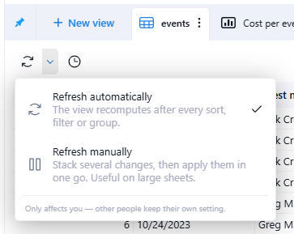<figcaption></figcaption></figure>

<figure>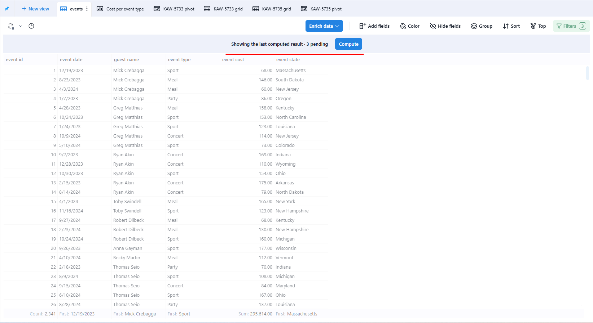<figcaption></figcaption></figure>

### 1.2 Sheets — Combined grouping

The **Group by** panel now has a **Layout** choice: **Nested** or **Combined**. **Combined** shows one header per combination of values, without subtotals per level.

* **Group header preview** — shows how the combined header will read, for example "event date · event state".
* **Separator** — choose the character between the parts: **·**, **/** or **—**.
* **Order** — drag the fields to change the order of parts in the label.
* **Reset** and **Apply** — discard or apply the configuration.

<figure>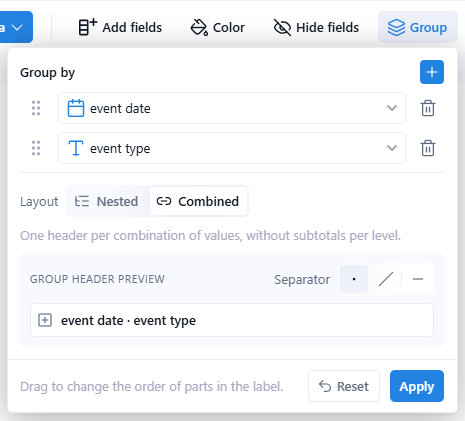<figcaption></figcaption></figure>

### 1.3 Sheets — Model page: new Sheet and AI Metadata tabs

The Model page, reworked in 1.36.4, gains two new tabs: **Sheet** and **AI Metadata**.

**Sheet** — sheet semantics: what a row is, how it joins, and how fresh it has to be. Semantics are required before the sheet is shared.

* **Row identity** — the **Primary key** is inherited from the data source and is read-only, with a link to open the data source. The **Grain**, the sentence people read (for example "One row per record id."), is drafted from the inherited key and can be overwritten.
* **Time & freshness** — **Time axis** (when it happened) and **As of** (when it was loaded; when not set, the platform refresh time is used), plus a **Max staleness** value and unit.
* **Relationships** — data the sheet brings in from elsewhere and how its rows are matched. Each line shows the source's name, its kind (**data source**, **sheet lookup**, **mapping table** or **script**), a badge for how rows match (**1:1**, **N:1** or **N:N**) and the column it is matched on, for example "Dataset_A · data source · N:1 · on State". A sheet without joins shows "This sheet uses only its own data source."
* **Ready to share** — a completeness score ("N % semantics complete") with a checklist covering the primary key, grain, time axis, max staleness and semantic types.
* **Personal data** — derived from the columns and set per column, not on this tab.
* **Semantic types** — the number of **Dimension**, **Measure**, **Time** and **None** columns.

<figure><figcaption></figcaption></figure>

**AI Metadata** — the context sent to AI Chat with each question asked about the sheet.

* **What this sheet is for** — a description of what the sheet holds and how the assistant should read it.
* **Columns in AI context** — each column with its description, origin and an **Include** toggle, plus a summary of how many columns are sent, excluded and missing a description. Descriptions are written in the **Columns** tab and shown here read-only; **Fix N in Columns** opens the **Columns** tab.
* **Context completeness** — "N % ready for AI Chat", with a checklist covering the sheet purpose, undescribed columns, excluded columns and sample rows. **Fix** next to undescribed columns also opens the **Columns** tab.
* **Beyond columns** — sheet-wide extras: **Documentation page** and **Sample rows** toggles.

<figure>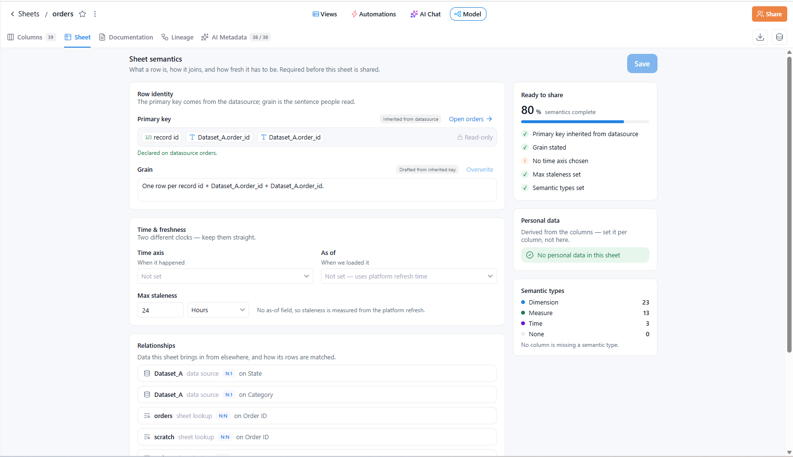<figcaption></figcaption></figure>

**Columns** — two improvements to the column grid:

* **Clickable visibility flags** — the letter chips in the **Visibility** column now toggle the flag directly:
    * On sheets: **D** (in default view), **S** (shared with viewers), **F** (default filter).
    * On data sources: **P** (primary key, LiveConnect only), **F**, **D**.
    * Chips you cannot change are greyed out, with a tooltip explaining why.
* **Origin and Kind** — a column's origin now reads the same everywhere:
    * **Origin** names the source you can open: the data source, or the sheet a lookup reads.
    * **Kind** names what produces the column: `lookup`, `formula`, `mapping`, the join key, or the script name.
    * This applies on the Model page, in the **Field information** / **Column information** popover, and in the group headers of every column picker (pivot and chart configuration, Add Fields, filters, control panel).
    * When the same data source is joined twice, each group shows its link name in brackets.

### 1.4 Data sources — Append only and Increment batch size

Incremental data sources can now be marked **Append only**, for incremental ETLs. Every loaded row is inserted as-is: rows are never merged on the primary key, so data that is loaded again appears twice.

* An **Append only** switch in the **Create new data source** dialog (**Classic** data sources, when the Incremental feed type is chosen).
* An **Append only** checkbox in the Overview's change-feed-type dialog, available while **Incremental** is selected.
* An **Append only** pill under the **Feed type** value on the Overview.

Mapping tables do not offer this option. Switching an append-only data source to **Reset before insert** hides the pill; switching back to **Incremental** restores it.

The flag can also be set through the API. `appendOnly` can be changed together with the loading mode in a single command, and `create-etl-and-datasource` accepts a `storageConfig` to set it at creation.

<figure>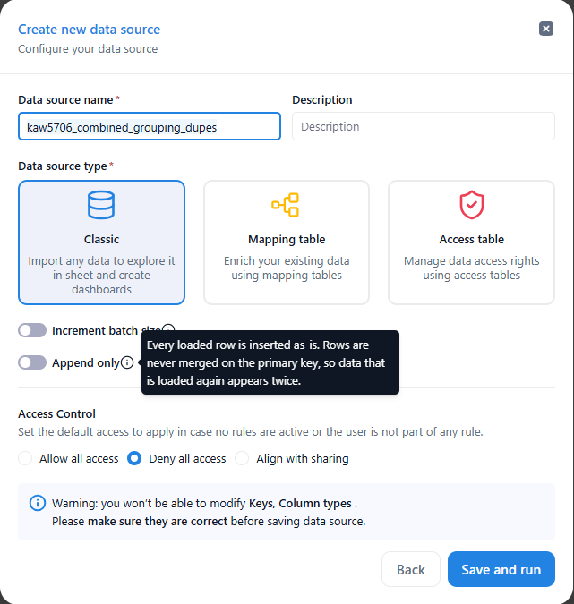<figcaption></figcaption></figure>

The **Create new data source** dialog also adds an optional **Increment batch size** switch for **Classic** data sources. It defines, in days, the section of the data that will be replaced at each load. When it is on, two required fields appear: **Temporal indicator** (a temporal column) and **Batch size in days**. The setting is chosen when the data source is created and cannot be changed later from the Overview.

<figure>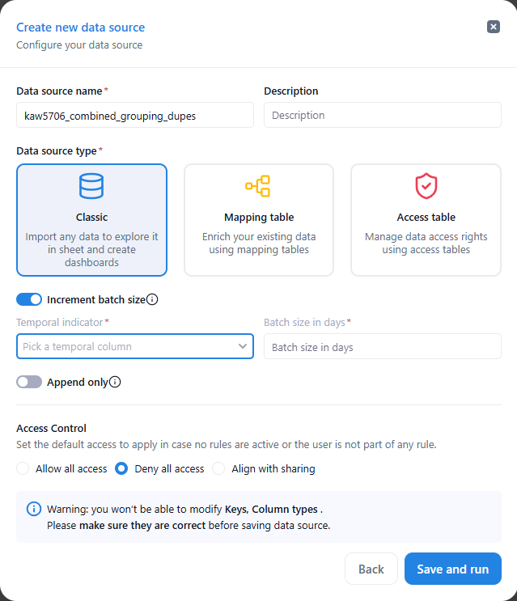<figcaption></figcaption></figure>

### 1.5 Workflows — Reworked User task

The **User task** step — "Pause the run until someone responds." — has been redesigned around how the assignee responds. A **What the assignee sees** panel previews the task as the assignee will receive it. Assignees also get an email with this summary and a direct link.

<figure>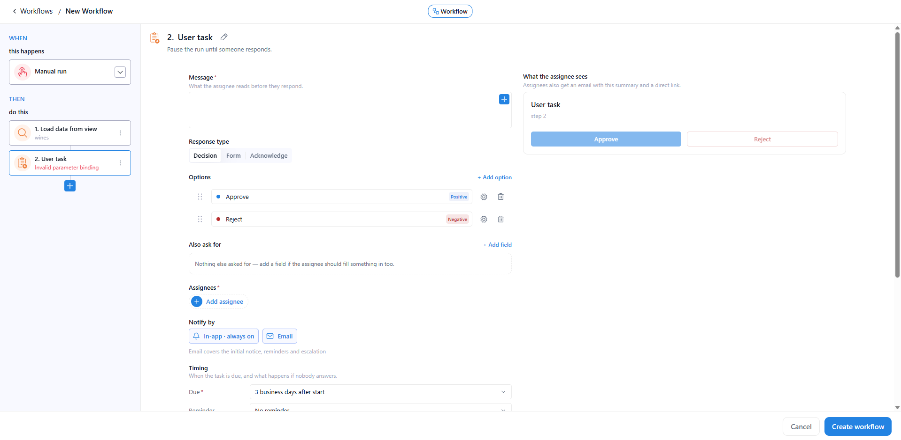<figcaption></figcaption></figure>

* **Message** — what the assignee reads before they respond. Workflow variables can be inserted into it.
* **Response type** — **Decision**, **Form** or **Acknowledge**:
    * **Decision** — the possible answers are listed under **Options** (**+ Add option**). Each answer can be reordered, configured or removed, and carries a tone such as **Positive** or **Negative** that colours the assignee's button. Additional input can be requested under **Also ask for** (**+ Add field**).
    * **Form** — the assignee fills in **Form fields** (**+ Add field**) and sends them with **Submit**. At least one field is required. Fields are listed as compact rows showing the field type, its label and a **required** / **optional** badge, and can be reordered, configured or removed.
    * **Acknowledge** — the assignee only confirms they have seen the task, with a **Got it** button.
* **Assignees** — shown as chips; **Add assignee** adds more people.
* **Notify by** — **In-app** is always on; **Email** can be added and covers the initial notice, reminders and escalation.
* **Timing** — when the task is due, and what happens if nobody answers. The settings are **Due** (required), **Reminder**, **Escalation** (**+ Add escalation**) and **If nobody answers** (**Interrupt the run**). A plain-English summary appears underneath, for example: "Due 2 hours after start, with a reminder 1 hour before. If nobody answers by then, the run is interrupted."
* **After it is answered** — for a **Decision**, choose **Continue** or **Interrupt** for each answer. Every other answer continues, and the answer is available as a variable.
* **Different path per answer** — **+ Add If / Else on the answer** adds an If / Else after the step, with one path per answer. An If / Else is no longer created automatically.

<figure>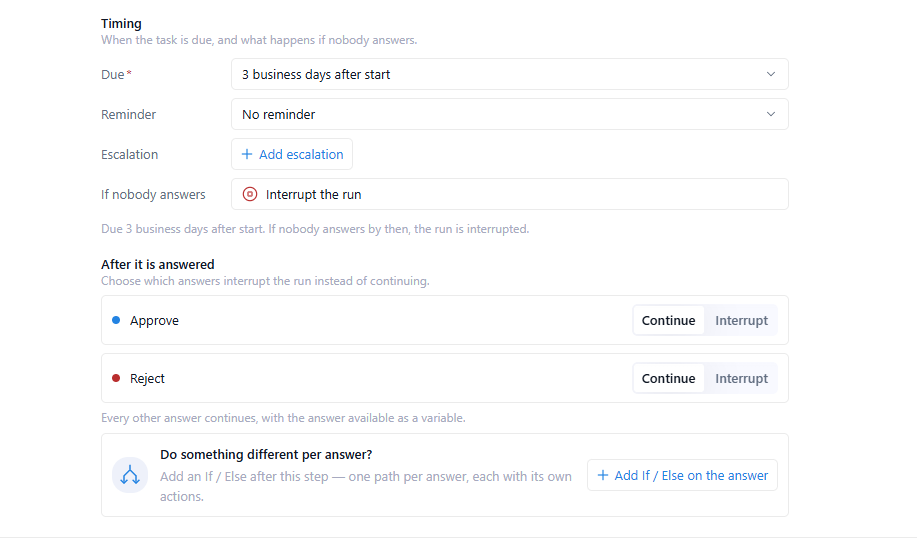<figcaption></figcaption></figure>

### 1.6 Workflows — If / Else redesign

* All branches are shown at once as cards, in evaluation order. Each card shows its **IF** / **ELSE IF** / **ELSE** badge, position, name, conditions and a summary of its actions.
* Conditional branches can be reordered by dragging; **ELSE** always stays last.
* Each branch has an **AND** / **OR** selector for combining its rules, shown from the second rule onwards.
* The **ELSE** branch can now be renamed.

<figure>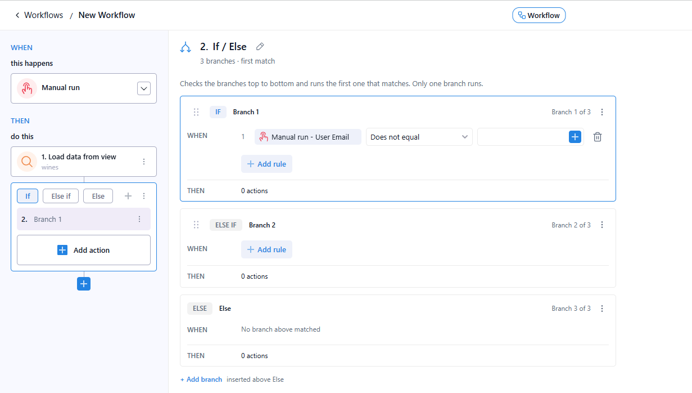<figcaption></figcaption></figure>

### 1.7 Workflows — Parallel loops

A **Loop** can now run its iterations in parallel. The new **Execution mode** setting offers two options:

* **Sequential** — one iteration at a time, in the order of the rows.
* **Parallel** — all iterations at once. They must not depend on each other.

<figure>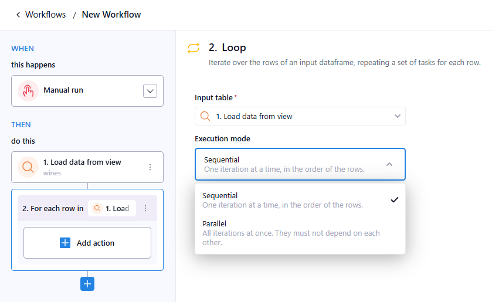<figcaption></figcaption></figure>

### 1.8 Artifacts — Markdown artifacts and creation with a file

* **Markdown type** — a new `Markdown` artifact type is rendered inline as formatted markdown in the preview.
* **Create with a file** — the **New Artifact** dialog adds an optional **Description** and **Upload file**. Picking a file creates the artifact together with its first version; without a file, the artifact is created empty as before.
* **File checks before upload** — invalid files are rejected immediately with an inline error:
    * Too large: "File is too large (max N MB)". The limit is 50 MB when creating an artifact and 200 MB when adding a version.
    * Wrong extension: "&lt;TYPE&gt; accepts &lt;extensions&gt;".
    * `Binary` artifacts accept any file.

> You can read more about this in the [Artifacts section](../artifacts.md).

### 1.9 Sharing — Admin access level

The **Share** dialog now offers a third access level for individual users and teams: **Viewer**, **Editor** and **Admin**. General access is unchanged and never grants Admin.

* **Admin** includes everything **Editor** allows, and also lets the user manage sharing: add or remove users and teams, change their access levels and change general access.
* Admin access does not allow deleting or archiving the entity. The user also still needs the workspace permission the owner would need, such as **Manage dashboards** to share a dashboard.
* On dashboards and applications, only the owner or a KAWA admin can make the entity private. For an Admin who is not the owner, **Apply** stays disabled once everything is restricted, and the dialog shows a notice such as "Only the owner can make this report private."
* In the **Share sheet** dialog, the switch of a view created by another user is now disabled, with the hint "Only the owner of this view can change its sharing." This also applies to the sheet's owner.
  Admin access is available for sheets, dashboards, data sources, workflows, skills, artifacts, applications and knowledge.

<figure>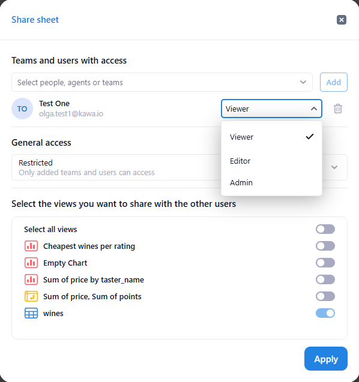<figcaption></figcaption></figure>

### 1.10 Administration & connectivity

* **Databricks** — connections can now authenticate with OAuth. 

  > You can read more about this in the [Databricks native connection section](../10_00_architecture/databricks-native-connection.md).
* **AWS Secrets Manager** — can be used as KAWA's secret store.
* **ClickHouse 26.8 LTS** — supported. 

## 2. Improvements & Bugs fixes

### 2.1 Sheets & views

* Fixed multi-cell selection in grid and pivot views:
    * Cells hidden by a collapsed column group are no longer counted in the stats or copied.
    * Ctrl+C in the grid copies cells in grid order. An uneven selection now shows "Copy action is not allowed on multiple sections" instead of a misaligned block.
    * Ctrl+C now works on non-Latin keyboard layouts (e.g. Ukrainian) and with Caps Lock on.
* Improved pivot responsiveness after "Collapse all" and when resizing group headers on large pivots.
* Added **Duplicate view** to default views of sheets with editable data sources.
* Fixed the expression editor opened from Add fields being editable in application view mode.
* Fixed the primary chart view not refreshing after the sheet was updated from a breakdown view.
* Changed the default date filter Conditions operator from OR to AND.

### 2.2 Dashboards

* Fixed filters bound to control parameters showing values from the sheet control panel instead of the dashboard control panel.

### 2.3 Workflows

* Updated the Interrupt step wording to state what actually stops:
    * At the top level: "Stop the run".
    * Inside a loop: "Stop this iteration".
    * With the error toggle on: "Stop the run with an error".
    * New Interrupt steps are named "Interrupt".
* Fixed nested loops: a task inside an inner loop can reference the enclosing loop, and Run history now shows the nesting correctly.
* Added validation for task inputs bound to a task that is not reachable (inside a branch or loop the task does not run in), so the workflow cannot be saved.

### 2.4 Data sources & Python

* Fixed the data loader auto-increment becoming negative.
* Fixed an error when patching data in transformation data sources.
* The Python data loader now compresses Arrow uploads and raises a clear error when the data source name is already taken.
* `compute()` in kywy now attaches a request id, which can be printed on demand and is always printed when an exception occurs.