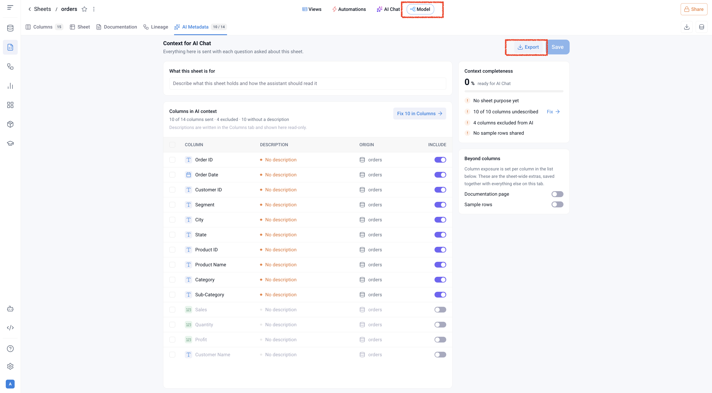
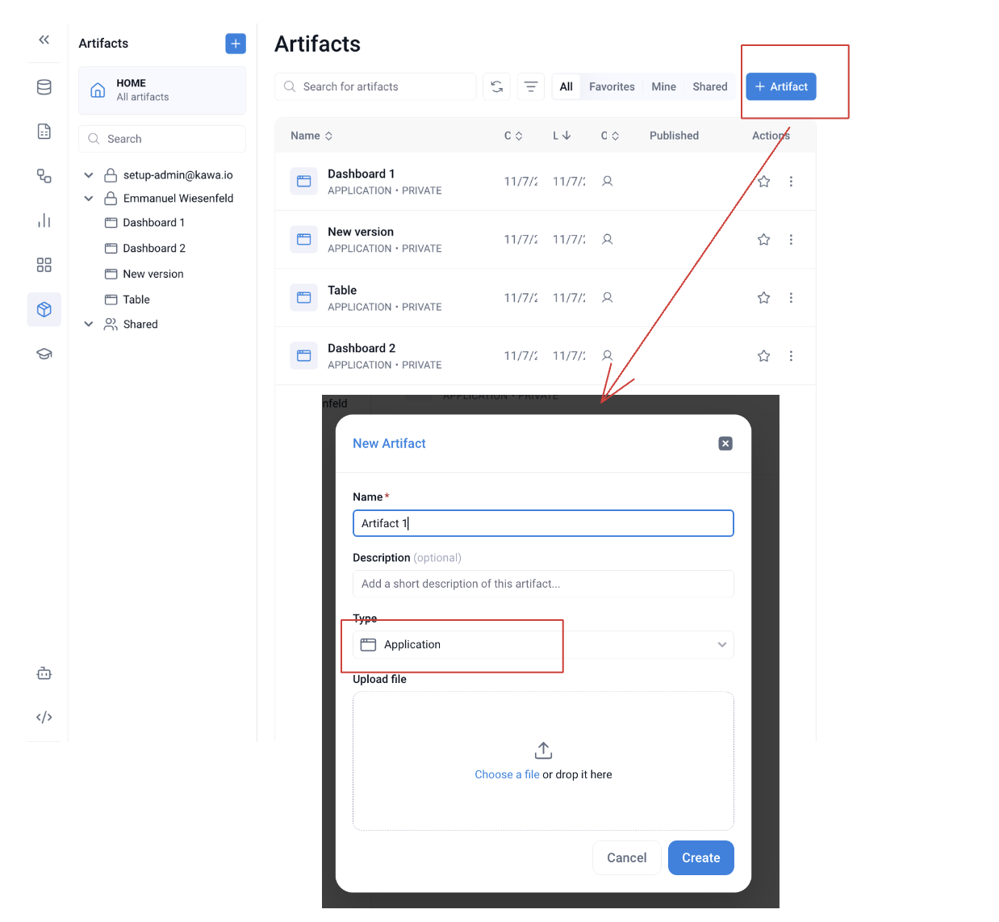
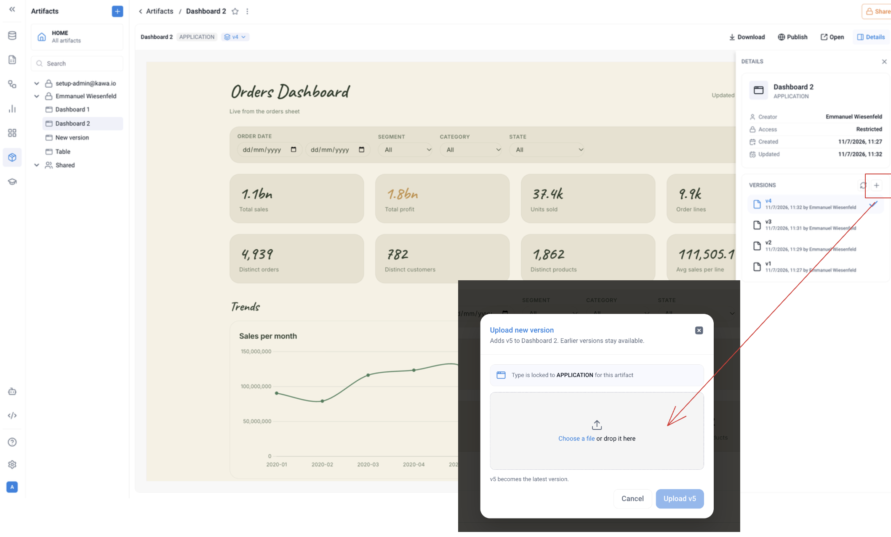

# Build a dashboard with your AI assistant

In a few minutes and without writing code: you download a small folder, give it to your AI assistant together with the description of your sheet, and the assistant builds a dashboard page. You then upload that page into KAWA as an artifact, where it runs live on your data.

What you need:

* A KAWA workspace with the sheet you want a dashboard on.
* An AI coding assistant that works in a folder on your computer: Claude Code, Cursor, Codex, GitHub Copilot or similar.

## Step 1 — Download the skill



1. Download the file above and unzip it. You get a folder named `build-kawa-artifact-lite`.
2. Put that folder in the folder where you work with your AI assistant.

That is the whole installation. Nothing to run, nothing to configure.


The folder contains instructions for the assistant and a ready-made page template. The assistant reads it on its own; you never need to open it.


## Step 2 — Export the description of your sheet

The assistant needs to know your sheet: its identifier, and the identifier, type and name of each column. KAWA exports this for you in one click.

1. Open your sheet in KAWA.
2. Click **Model** at the top of the screen.
3. Open the **AI Metadata** tab.
4. Click **Export**. A small text file is downloaded.

<div data-with-frame="true"><figure><figcaption>The Model view of a sheet, AI Metadata tab: Export is at the top right.</figcaption></figure></div>


**Only the columns whose Include switch is on are exported.** Before you click Export, turn the switch on for every column you want in the dashboard, and off for the ones the assistant should not see. In the screenshot above, Sales, Quantity, Profit and Customer Name are off: they would not be exported.


The exported file is short and looks like this. The first line is the sheet, then one line per column with its identifier, its type and its name:

```
sheet orders_prrtng3g0q "orders"
_ci_order-id      text  "Order ID"
_ci_order-date    date  "Order Date"
_ci_customer-id   text  "Customer ID"
_ci_segment       text  "Segment"
```

## Step 3 — Ask for the dashboard

1. Open your AI assistant in the folder that contains `build-kawa-artifact-lite`.
2. Open the exported file and copy its content.
3. Send the assistant a message in three parts: where the folder is, the content of the exported file, and what you want.

Here is a complete example. Replace the sheet lines with your own export.

```
You have a folder called ./build-kawa-artifact-lite (in the current folder) - it explains how to build artifacts.

sheet orders_prrtng3g0q "orders"
_ci_order-id      text  "Order ID"
_ci_order-date    date  "Order Date"
_ci_customer-id   text  "Customer ID"
_ci_segment       text  "Segment"
_ci_city          text  "City"
_ci_state         text  "State"
_ci_product-id    text  "Product ID"
_ci_product-name  text  "Product Name"
_ci_category      text  "Category"
_ci_sub-category  text  "Sub-Category"

Build me a dashboard on top of this sheet.
```

The assistant creates one file in the folder, for example `orders.html`. That file is your dashboard.

You can ask for changes in the same conversation, in plain language: "add a chart of orders per month", "add a table of the latest orders with the city and the state", "use a dark theme". The assistant updates the file.


You can say what matters to you in the first message: the figures you want to see first, the breakdowns that make sense for your business, the columns to show in the table. The more precise the request, the closer the first result.


## Step 4 — Upload the dashboard into KAWA

### A new artifact

1. In KAWA, open **Artifacts** in the left bar.
2. Click **+ Artifact** at the top right.
3. Give the artifact a name.
4. Choose the type **Application**.
5. Drop the file created by your assistant in the upload area, or click **Choose a file** and pick it.
6. Click **Create**.

<div data-with-frame="true"><figure><figcaption>New artifact: type Application, then the file.</figcaption></figure></div>

Open the artifact: the dashboard shows, live on the sheet's data. **Open** shows it full screen. To give it to your team, see [Artifacts](../artifacts.md).

### A new version of an existing artifact

When you asked the assistant for changes, upload the updated file as a new version of the same artifact. Earlier versions stay available.

1. Open the artifact.
2. If the right panel is not shown, click **Details** at the top right.
3. In the **Versions** list, click **+**.
4. Drop the updated file in the upload area and click **Upload**.

<div data-with-frame="true"><figure><figcaption>Versions, then +: the new version becomes the current one.</figcaption></figure></div>

Select an earlier version in the list to go back to it.

## Good to know

* The dashboard is not a copy of your data. Each time it opens, it asks KAWA for the current figures.
* Filters, quick date ranges, clicking a bar or a slice to filter the page, paging and sorting in tables and row details are built in. You do not need to ask for them.
* The assistant never connects to KAWA. It only sees what you exported: the identifiers, types and names of the columns you included. No data leaves KAWA while the dashboard is built.
* If the assistant needs a column that was not exported, go back to Step 2, turn its switch on, export again and give the new content to the assistant.
