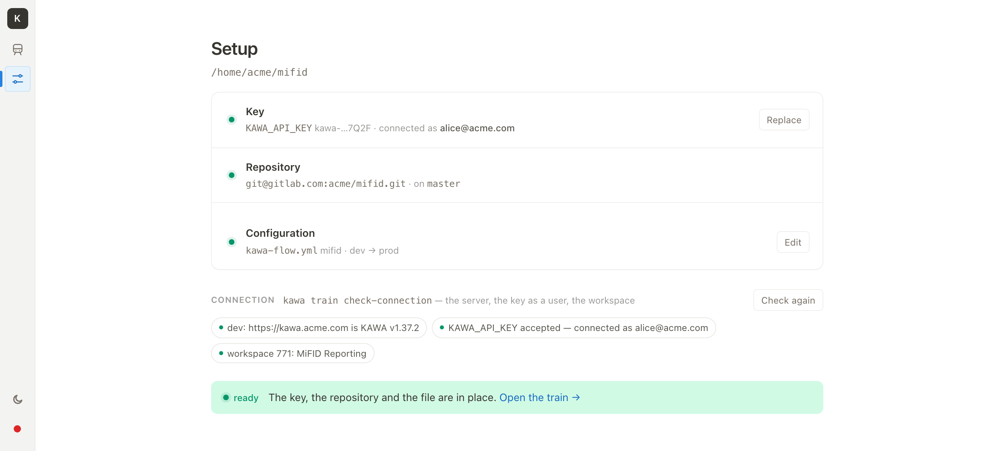
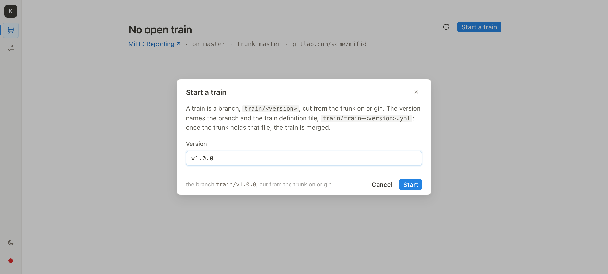
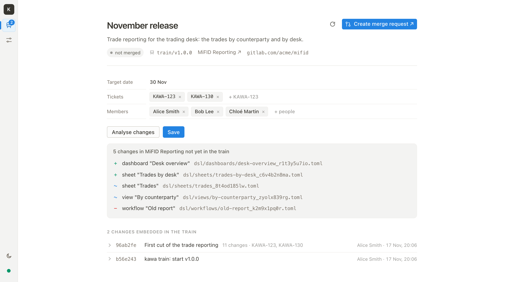
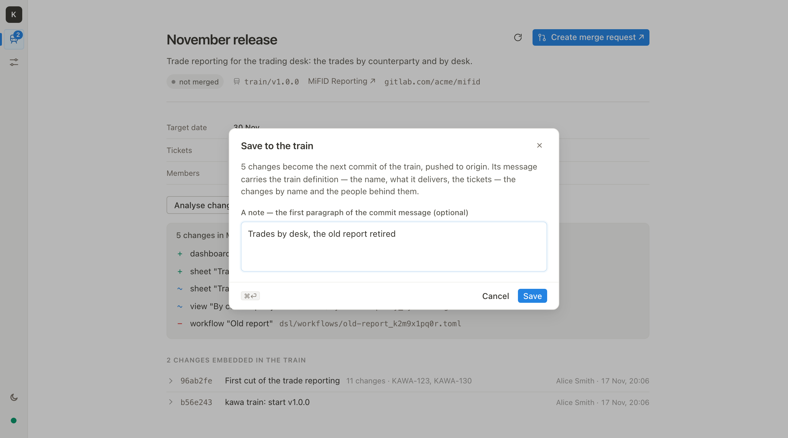
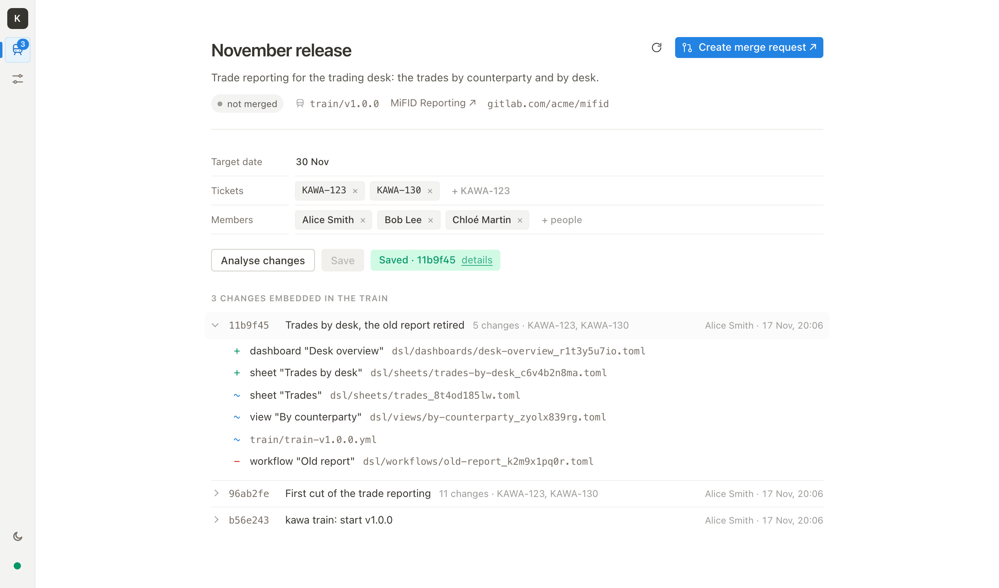
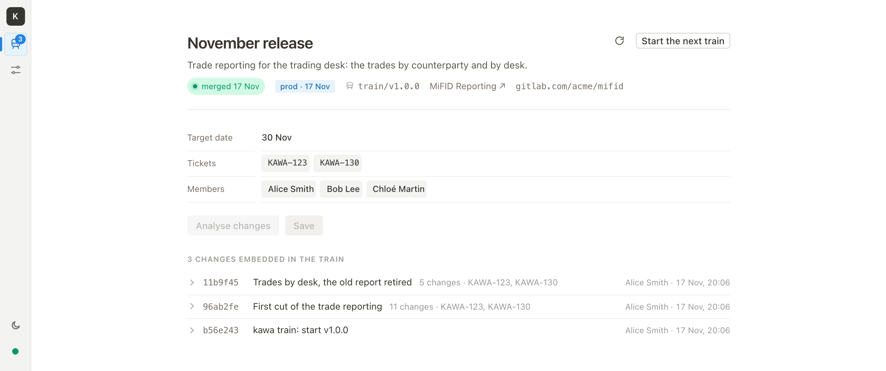
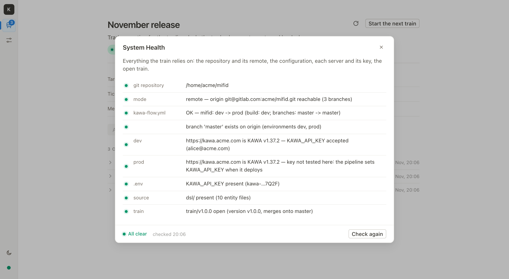

# Step-by-step guide

This guide takes a team's development workspace to production through a first release train, one step at a time, with the command or the click and the output you should see. The [Reference](reference.md) has the full syntax of each verb and file.

The example: a flow named `mifid`, one KAWA server at `https://kawa.acme.com`, workspace 771 for development and workspace 773 for production, a Git repository hosted on GitLab.

## Before you start

* Python 3.11 or newer and `git` installed on the train manager's machine.
* A **development workspace** that already holds the team's work.
* A **production workspace**, empty, controlled: nobody edits it, only the pipeline's service account writes.
* A **Git repository on your host** (GitLab, GitHub or Bitbucket), empty, that the train manager can push to.
* The train manager's **API key** on the development server (*Settings → API keys*). No production key on any laptop.

```bash
pip install kawa-dsl
kawa train --help
```

## 1. Set up the flow

Open the page in an empty directory; it opens in your browser:

```bash
mkdir mifid && cd mifid
kawa train
```

```
kawa train — http://127.0.0.1:51324/?t=8f2c…
```

The page has two screens, on the rail at the left: **Train** and **Set up the flow**. In an empty directory it opens on the setup. Three things make the flow ready, from top to bottom:

1. **The configuration**, `kawa-flow.yml`. *Insert an example* gives you a starting point; the simplest one describes two environments:

   ```yaml
   name: mifid
   environments:
     - name: dev
       url: https://kawa.acme.com
       workspace: 771
       build: true       # the DEV workspace where everyone builds
     - name: prod
       url: https://kawa.acme.com
       workspace: 773
       controlled: true  # deploy-only
   ```

   Put your workspace ids in and **Save**. The page creates the Git repository and commits the file on the trunk, `master`.

2. **The DEV key**, pasted into the key row. It goes into `.env`, which is git-ignored: the key never reaches the repository.

3. **The repository**: the URL of your empty repository on the host. *Connect* adds it as `origin` and pushes the trunk.

The line at the bottom turns to *ready*. The doctor (the dot on the rail) runs every check and shows them; it is green from here on.

<div data-with-frame="true"><figure><figcaption>The setup, ready: the key, the repository, the configuration, and the connection check under them.</figcaption></figure></div>

Prefer a terminal? `kawa flow init`, a `.env` with `KAWA_API_KEY=…`, `kawa flow origin <url>` and `kawa flow doctor` do the same, as in the [reference](reference.md#setting-up-from-the-terminal).

## 2. Start the first train

On the **Train** screen, *Start a train* asks for a version. Versions are yours to choose; the page suggests the next one and lists the previous trains. The first is `v1.0.0`:

```
train/v1.0.0 cut from origin/master, checked out and pushed (593a06e) — name it, put the tickets on it, save
```

<div data-with-frame="true"><figure><figcaption>Start a train: the version names the branch, <code>train/v1.0.0</code>.</figcaption></figure></div>

The train is a branch on `origin`, with one commit: its record, `train/train-v1.0.0.yml`. The screen now shows the train, **not merged**, with its record to fill in:

* **the name**, typed in the title: it becomes the merge request's title;
* **a description**, in business words;
* **a target date**;
* **the tickets**, as chips: `KAWA-123`, `KAWA-130`;
* **the members**, picked among the workspace's members.

Every field is saved to the record as you leave it.

## 3. Build, then analyse and save

The team builds in the DEV workspace, in KAWA, as always. Whenever the train manager wants the train to carry the workspace as it stands, two buttons:

* **Analyse changes** exports the DEV workspace and compares it with the train's tip. The differences are listed by entity: `+ sheet "Trades"`, `~ view "By counterparty"`, `- workflow "Old report"`. The page says *Nothing new* when the train already holds everything.
* **Save** asks for an optional note, then exports the workspace over the train and commits it, pushed to `origin`:

```
kawa train save — /home/acme/mifid
  ✓ train/v1.0.0 pulled from origin
  ✓ dev workspace 771 pulled from https://kawa.acme.com over the tree: 27 entities, files and data included
  ✓ saved on train/v1.0.0 (eb234ab): 27 changes, 2 tickets and pushed
```

<div data-with-frame="true"><figure><figcaption>Analyse changes: what the DEV workspace holds that the train does not, by entity.</figcaption></figure></div>

<div data-with-frame="true"><figure><figcaption>Save: the note becomes the commit's title.</figcaption></figure></div>

The note is the commit's title. The commit message carries the train's record, the tickets, the changes by name and, for each change, the owner of the entity in KAWA. That is how the trail says who built what, although the train manager is the one who commits. The *details* link next to the Saved label shows the message.

A change to the record alone, a new ticket or a renamed train, is saved the same way, with no workspace change.

The saves appear under **changes embedded in the train**, newest first, each with its note and its count; opening one lists what it changed.

<div data-with-frame="true"><figure><figcaption>After the save: the Saved label, and the save opened on what it changed.</figcaption></figure></div>

Save as often as you like. A train is not one change; it is the DEV workspace at a point in time.

## 4. The merge request

When the train is ready, **Create merge request** opens the host's own form, with the source branch, the target branch and the title filled in. The review and the merge are the host's, under its own rules: protected trunk, required approvers, the approver not being a train member.

The train manager cannot merge. Nothing in KAWA Train merges or deletes anything on the host.

## 5. Merged

The page knows the train is merged the moment `origin/master` holds `train/train-v1.0.0.yml`, which the merge brought there. The chip reads **merged 27 Oct**, every field of the record becomes read-only, and **Start the next train** appears. Any merge method of your host works: a merge commit, a squash, a fast-forward or a rebase.

The merged train stays on the page under **previous trains**, with its merge date.

## 6. Deploy to production

Production is deployed by the pipeline, from a clone of the repository, with the production key in `KAWA_API_KEY`. The version says what to deploy:

```bash
kawa train deploy prod --ref v1.0.0 --plan     # the plan, nothing applied
kawa train deploy prod --ref v1.0.0 --yes      # applied, no prompt
```

```
kawa train deploy prod v1.0.0 — /builds/acme/mifid
  ✓ v1.0.0 at 7e51101: 27 entities
  ✓ evidence: prod/20261028T091402.512033Z-v1.0.0-started.json (3f2a1c0)
  ✓ deployed onto prod workspace 773 on https://kawa.acme.com (files and data included)
  ✓ evidence: prod/20261028T091530.004811Z-v1.0.0-finished.json (a2b9c47)
```

`v1.0.0` resolves to the trunk commit that carries the train: the merge commit, the squash commit, or the train's last save after a fast-forward. Later commits on master are never picked up.

With a `uat` environment before `prod` in `kawa-flow.yml`, `kawa train deploy prod --ref v1.0.0` deploys the commit the uat evidence recorded for `v1.0.0`, and refuses while uat has not applied it: what was tested is what goes live.

The two `evidence` lines are the proof: a `started` record before the target was touched, a `finished` record after, both pushed to the `evidence` branch of your repository. `--json` prints the closing record for the job log and the change ticket.

Two flags a job may need:

* `--delete` removes from the environment what the train does not declare. Without it, a deploy that would delete something stops before applying anything and lists the deletions. A controlled environment that nobody edits should always match the train, so a pipeline passes it.
* `--skip-large` deploys an artifact up to its last version whose payload is in the tree. Save leaves a non-application payload above 2 MB on DEV; without the flag, such a version refuses the deploy and is named.

A GitLab job for it:

```yaml
deploy-prod:
  stage: deploy
  when: manual
  variables:
    GIT_DEPTH: 0                     # the whole history: the version is looked up on master
    KAWA_API_KEY: $KAWA_PROD_API_KEY # a protected variable: the production service account's key
  script:
    - pip install kawa-dsl
    - kawa train deploy prod --ref "$VERSION" --yes --delete --json
```

Back on the page, the merged train now carries a chip: **prod · Oct 28**. That is read from the evidence branch.

<div data-with-frame="true"><figure><figcaption>The train merged and deployed: both chips, the record read-only, <strong>Start the next train</strong>.</figcaption></figure></div>

## 7. The next train

**Start the next train** cuts `train/v1.1.0` from the new tip of master, so it starts empty however the previous one was merged. The loop from step 3 repeats: build, analyse, save, merge request, merge, deploy.

Every train that shipped is listed under previous trains, with where it is deployed. The current version of each environment is in accent; a replaced one in grey.

## 8. When something goes wrong

* **The doctor** on the rail runs every check whenever you open it: the repository, the remote, the configuration, the servers, the key, the open train. It names what to do.
* **A deploy that failed** is on record: a `failed` record with the error. The next deploy runs. If a job was killed between its `started` and its end, the environment stays held; the pipeline's owner closes it:

  ```bash
  kawa train close prod -m "the job was killed"
  ```

* **A save refused** for uncommitted changes means someone edited the repository by hand. The train commits the workspace as it stands, nothing else: commit or stash the edit first.

<div data-with-frame="true"><figure><figcaption>The doctor: System Health, opened from the dot at the bottom of the rail.</figcaption></figure></div>

## Quick reference: a train from the terminal

Every step of this guide has a command. This is the whole loop for a train manager who works without the page.

**Once, to set up the flow:**

```bash
pip install --upgrade kawa-dsl
mkdir mifid && cd mifid
kawa flow init --name mifid --url https://kawa.acme.com --dev-workspace 771 --prod-workspace 773
# edit kawa-flow.yml: `build: true` on dev, `controlled: true` on prod
# put the DEV key in .env: KAWA_API_KEY=kawa-…
git add kawa-flow.yml && git commit -m "the flow"
kawa flow origin git@gitlab.com:acme/mifid.git    # adds origin and pushes the trunk
kawa flow doctor                                  # every line must be ✓
kawa train check-connection                       # the server, the key, the workspace
```

**For each train:**

```bash
kawa train start v1.0.0                     # one train at a time: the previous one must be merged
kawa train tickets add KAWA-123 KAWA-130    # the tickets on the train
kawa train save -m "the Q3 cut"             # the whole DEV workspace as one commit, pushed
kawa train status                           # the saves and the merge request link
```

The name, the description and the target date are fields of `train/train-v1.0.0.yml`: edit the file, the next save carries it. Save as often as you like; a save ends with `saved on train/v1.0.0 (…): N changes … and pushed`, or says there is nothing to save.

The approver merges the merge request on the host. Then:

```bash
kawa train status                           # the train reads "merged"
kawa train start v1.1.0                     # the next train, before any other save
```

**In the pipeline, with an administrator's key of the target in `KAWA_API_KEY`:**

```bash
kawa train deploy prod --ref v1.0.0 --plan            # the plan, nothing applied
kawa train deploy prod --ref v1.0.0 --yes --delete    # applied, no prompt
```

**If a change is missing from a save:**

* **The key does not read the whole workspace.** A save needs an administrator's key, or the key of a user who holds the `WORKSPACE_EXPORTER` permission on the workspace. Before `kawa-dsl` 2.5.7, a save with another key left out what other members had not shared with its user: upgrade and save again.
* **A `.gitignore` rule hides the file**, `*.csv` for instance. The save refuses and names the rule; before 2.5.7 the file was left out without a word.
* **The train was already merged.** A save on a merged train stays on its branch and never reaches the trunk: start the next train first.
* **The save was refused.** It prints `kawa train save: <why>` and commits nothing when the train's branch is not checked out, when the repository has edits made by hand, or when the branch has diverged from origin.
* **The change is in another workspace** than the DEV one `kawa-flow.yml` names.
* **It is not a change for the train**: a column list in another order, or an artifact payload above 2 MB that is not an application, which stays on DEV.
