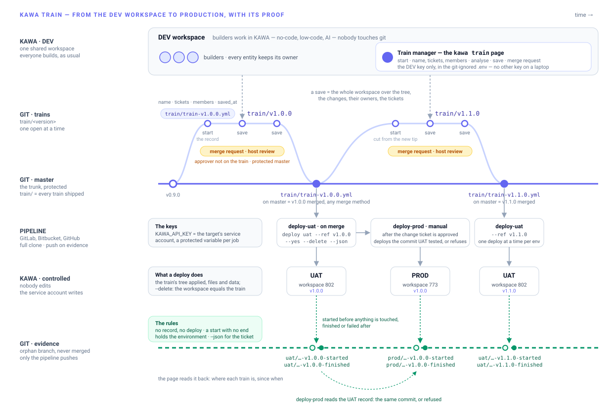

# SDLC — governed delivery & SOX controls

KAWA ships a development lifecycle for analytics that reaches production as a sequence of **release trains**. A team builds in one development workspace, in KAWA, as usual. The train manager puts the workspace on a train, a branch of a Git repository; the Git host's merge request is the review; a pipeline deploys the merged train onto the controlled environments by its version; and every deploy leaves its proof on a dedicated branch. Nothing reaches a governed environment except a merged train, deployed by the pipeline's own service account.

This page is the control view of that model: what each mechanism guarantees and how an auditor verifies it. The tooling itself is documented under [KAWA Train](kawa-flow/README.md): the [step-by-step guide](kawa-flow/step-by-step.md) and the [reference](kawa-flow/reference.md).

## 1. Two operating models

**Not every use case needs a pipeline.** KAWA offers two operating models, and the choice is per use case, not per platform. Most deployments run both side by side.

| Model | How it works | Use it for |
| --- | --- | --- |
| **Free mode** | One shared workspace. KAWA's permission system separates **builders** (create and edit) from **explorers** (consume, filter, drill). No trains, no gates: changes are live immediately. | Self-service analytics: internal dashboards, ad-hoc analysis, team reporting. |
| **Train mode** | The lifecycle described on this page: a development workspace, release trains on Git, a reviewed merge, controlled environments deployed by the pipeline, evidence per deploy. | Mission-critical and SOX-scoped processes: reconciliation, regulatory reporting (MiFID, EMIR), financial close. |

In Free mode, governance *is* the permission model, see [Sharing and permissions](08_00_administration/08_01_permissions.md). In Train mode, governance is structural: a controlled environment has one writer, the pipeline, and the pipeline deploys only what the trunk carries. The rest of this page describes Train mode.

## 2. The model in one picture

<figure><figcaption></figcaption></figure>

Six things, top to bottom:

1. **One DEV workspace where everyone builds.** Builders work in KAWA, no-code, low-code or with AI, and never touch Git. Every entity keeps its owner.
2. **A train is a branch**, `train/<version>`, cut from the trunk. One train is open at a time. Its commits are *saves*: the whole DEV workspace exported over the tree, with the changes by name, the owner of each changed entity and the tickets in the commit message. The train's **record**, `train/train-<version>.yml`, travels with it: name, description, target date, tickets, members.
3. **The merge request is the review**, on the Git host, under the host's own rules: protected trunk, required approvals, an approver who is not on the train. When it is merged, the record lands on the trunk, and that is what makes the train **merged**, whatever the merge method. The trunk's `train/` folder is the list of every train that shipped.
4. **The pipeline deploys by version.** `kawa train deploy uat --ref v1.0.0` finds the trunk commit that carries the train and applies it to the environment, headless, with the environment's service account key from a protected variable. UAT follows a merge; PROD is a manual step, after the change ticket is approved.
5. **Controlled environments have one writer.** Nobody edits UAT or PROD: the pipeline's service account applies the train, and `--delete` keeps the environment equal to the train.
6. **Every deploy writes its evidence** to the `evidence` branch: a `started` record before the target is touched, a `finished` or `failed` record after. PROD deploys the exact commit the UAT record names, or refuses.

## 3. Who does what

| Role | Does | Never |
| --- | --- | --- |
| **Builders** | Build in the DEV workspace | Commit, merge, deploy |
| **Train manager** | Starts the train, names it, puts the tickets and members on it, saves the workspace onto it, opens the merge request | Approve the merge, deploy to a controlled environment |
| **Approver** | Reviews and merges the merge request on the Git host | Build, deploy |
| **Business owner** | Approves the change ticket that releases the PROD step | Build, merge, deploy |
| **Pipeline** | Deploys the merged version onto UAT and PROD with its own service account, and writes the evidence | Edit anything |

Only the DEV key is on a laptop. The keys of the controlled environments live in the pipeline, as protected variables, and nowhere else.

## 4. SOX controls

The lifecycle above *is* the control framework. This section maps the controls an auditor looks for onto the mechanism that enforces each one, and says where the enforcement sits: in KAWA Train, on the Git host, or in the pipeline.

### 4.1 Change authorisation

**No change reaches a controlled environment without a reviewed merge and an approved ticket.**

| Control | Mechanism | Enforced by |
| --- | --- | --- |
| Every change is on a train | A save commits the whole DEV workspace; the merge request diff is the train's content | KAWA Train |
| Every train carries its tickets | The record holds them, and every save repeats them in the commit message | KAWA Train, the ticketing convention of the team |
| The trunk is protected | Merge requests only, required approvals, no direct push | Git host |
| The approver is independent | The approver is not the train manager, a member of the train, or an owner of a changed entity | Git host rule today; `kawa train approver`, a host-agnostic check reading the record and the commits, is planned |
| PROD waits for the business | The PROD job is manual, released after the change ticket is approved | Pipeline |

### 4.2 Segregation of duties

**No single person builds, approves and deploys.** The same identity never fills two of these roles for one train.

| Role | Responsibility | Enforced by |
| --- | --- | --- |
| Builder | Builds in the DEV workspace | KAWA permissions on the DEV workspace |
| Train manager | Commits the workspace onto the train, opens the merge request | Cannot merge: protected trunk |
| Approver | Merges | Cannot deploy: no controlled environment key |
| Pipeline service account | The only writer on UAT and PROD | Key custody: the pipeline alone holds the environment's key. The server-side lock, one writer and everyone else an explorer, is being built in the KAWA server |

The service account is a KAWA principal of its own kind: it belongs to one workspace for life, cannot switch workspace, and its key is useless against any other environment on the same server. A UAT key cannot write to PROD.

### 4.3 The same thing is tested and released

**PROD runs the commit UAT tested.** A version resolves to the trunk commit that brought its record, so two deploys of `v1.0.0` from the same trunk give the same tree. When an environment follows another one in `kawa-flow.yml`, the deploy goes further: it reads the predecessor's last applied record on the evidence branch and deploys that commit. It refuses when UAT has no applied deploy of the version, and when the trunk's lookup now names another commit than the one tested. A sha given by hand skips the chain, and the record then shows the sha where a version would be.

### 4.4 Traceability and evidence

**Every deployment writes its own evidence, before and after, to a branch nobody merges.**

| Record | Written | Holds |
| --- | --- | --- |
| `started` | Once the target answers, before anything is applied | Environment, workspace, URL, version, commit and tree hash, who (git identity and the key's KAWA principal), host, the pipeline's job identifiers, the flags, the environment it was tested on |
| `finished` | After the apply | The same, plus the result, the retries, what was left out, whether deletions were allowed, the steps |
| `failed` | After a failure, or by `kawa train close` | The same, plus the error and the step |

The rules the branch enforces:

* **No record, no deploy.** A `started` record that cannot be pushed refuses the deploy and leaves nothing behind.
* **One deploy at a time.** A `started` with no end holds the environment: the next deploy refuses, naming the version, the time and the person, until a `finished` or `failed` follows. Two deploys starting together are settled by the push: one lands, the other reads the branch again and stops.
* **The ticket gets the record.** `kawa train deploy --json` prints the closing record for the job log and the change ticket.

What makes the branch impartial is the Git host: `evidence` is protected so that only the pipeline's identity pushes to it and nobody force-pushes. A deploy run from a laptop writes with that person's identity, which the review sees.

**The audit trail, in one walk.** From a PROD record: the version, the commit, who deployed, when, the UAT record it was tested on. From the commit on the trunk: the train's record with its tickets and members, every save with the changes by name and the owner of each. From the merge request on the host: who approved. From the ticket: who authorised the release. Each hop is a file in Git or a page on the host; none of it is editable in KAWA.

### 4.5 The controlled environment

**Nobody edits UAT or PROD.** Each is a KAWA workspace flagged `controlled: true` in `kawa-flow.yml`: deploy-only, written by the pipeline's service account. Today that rests on key custody, the service account's key being in the pipeline and nowhere else, and on the deploy: `--delete` removes what the train does not declare, so the environment equals the train after every deploy, and a hand edit is a difference the next deploy's plan shows and removes. The server-side lock, where the service account is the one writer and everyone else is an explorer, admins included, is being built in the KAWA server.

### 4.6 Secrets and connection isolation

**The tree never contains credentials or queries.** A datasource is declared by its tag and columns. Where it is a live connection on an environment, an override of that environment in `kawa-flow.yml` says so, and the deploy never pushes its rows: when the environment holds the datasource, its columns must contain the tree's, by tag and type, or the deploy is refused; when it lacks it, the deploy creates the connection with the tree's columns and a placeholder query, and the real query and its credentials are put in on the target, outside the DSL. The keys live in `.env` on the train manager's machine, git-ignored, and in the pipeline's protected variables. No secret is in Git, in a workspace definition, or in the evidence.

## 5. What the host and the pipeline must provide

KAWA Train enforces what it can see: the trunk, the trains, the evidence, the deploy. Three things are the host's and the pipeline's, and the setup is not complete without them:

1. **Branch protection** on the trunk (merge requests only, required approvals) and on `evidence` (push by the pipeline identity only, no force-push).
2. **The pipeline file**, from the templates shipped with the DSL (`pipelines/` in the kawa-dsl repository: GitLab, Bitbucket, GitHub), with the service account keys as protected variables, a full clone, and the PROD step manual.
3. **The change ticket**, raised after the UAT deploy with the `--json` record, approved by the business owner before the PROD step is released.

## 6. Command reference

| Command | Persona | What it does |
| --- | --- | --- |
| `kawa train` | Train manager | Opens the page: start, record, analyse, save, merge request, previous trains, where each is deployed |
| `kawa train start <version>` | Train manager | Cuts `train/<version>` from the trunk on origin, with its record |
| `kawa train save [-m note]` | Train manager | Exports the DEV workspace over the train and commits it, pushed |
| `kawa train status` | Anyone | The train, its saves, merged or not, the shipped trains and their deployments, from Git |
| `kawa train deploy <env> --ref <version> --yes\|--plan [--delete] [--skip-large] [--json]` | Pipeline | Deploys a version onto an environment, headless, with its evidence |
| `kawa train close <env> -m "why"` | Pipeline owner | Closes a `started` record no end followed, on record |
| `kawa flow doctor` | Anyone | Every check: the repository, the remote, the configuration, the servers, the key, the tree, the overrides, the open train |

The full syntax of each verb, the `kawa-flow.yml` file, the record and the evidence branch are in the [reference](kawa-flow/reference.md).
